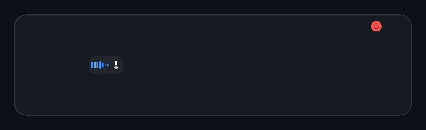
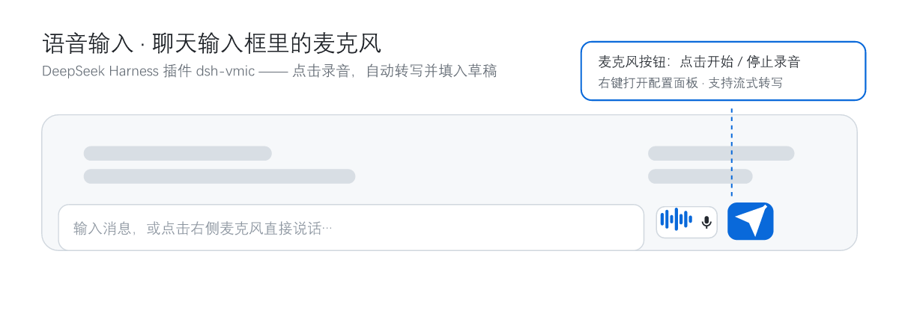
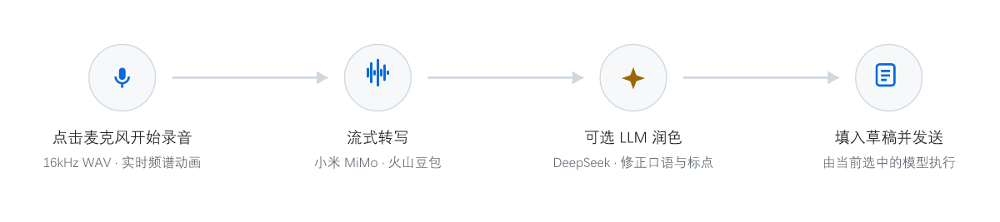
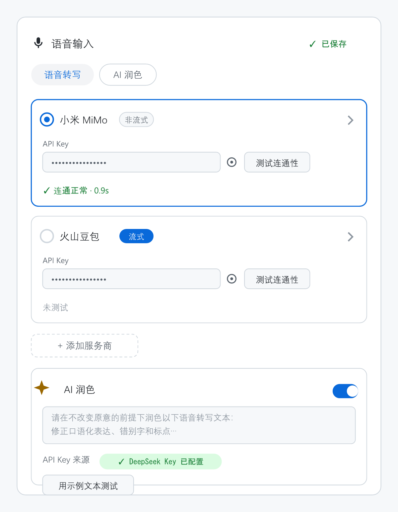

# dsh-vmic — 语音输入插件（Voice Input for DeepSeek Harness）

<p align="center">
  
</p>

DeepSeek Harness（DSH）的语音输入插件：在聊天输入框旁新增一个 🎙️ 麦克风按钮（带实时频谱动画），录制 16kHz WAV 语音并转写成文字，填入输入草稿供你审阅——**真正执行请求的仍是 DSH 中当前选中的模型**，语音识别只承担"听写"层，与主模型完全解耦。

## 界面一览

<p align="center">
  
</p>

麦克风按钮位于发送按钮左侧：**点击开始录音，再次点击停止并转写**；右键按钮可随时打开配置面板。

## 特性

- 🎙️ 输入框工具栏的麦克风按钮（发送按钮左侧）：点击开始录音，再次点击停止并转写。
- 📊 录制时实时频谱动画（Canvas 绘制，主题跟随 harness CSS 变量）。
- ⚡ 两种内置转写供应商，右键按钮打开配置面板即可切换：
  - **小米 MiMo**（`openai-compatible`，`input_audio` 方式，模型 `mimo-v2.5-asr`）
  - **火山豆包**（SAUC bigmodel WebSocket 二进制帧协议，模型 `bigmodel`，资源 `volc.bigasr.sauc.duration`，支持**流式**转写）
- ✨ 可选 LLM 润色（默认复用 DSH credentials 中的 `DEEPSEEK_API_KEY`，`deepseek-chat`）：去除口语化、修正错别字与标点；也可在面板中配置自定义润色 Key。
- 🔒 API Key 只存在于 DSH 服务端（credentials 密封，命名 `VMIC_<ID>_API_KEY`），浏览器只能看到"已配置/未配置"状态，拿不到明文。
- 🧪 内置供应商连通性测试：发送 0.5s 测试音，返回延迟与识别文本，快速定位网络/鉴权问题。
- 🌐 中文 / 英文 UI 字符串。

## 使用流程

<p align="center">
  
</p>

1. 点击 🎙️ 开始录音（允许浏览器麦克风权限）。
2. 再次点击（或红色方块）停止：完整音频转写一次。
3. （可选）开启润色后自动调用 LLM 整理。
4. 文字进入输入草稿（保留你已有的草稿），检查后回车发送——由当前选中的模型执行。

## 配置

<p align="center">
  
</p>

右键麦克风按钮打开配置面板：

- **供应商**：选择当前使用的供应商（`selectedProvider`）、开关与自定义 `openai-compatible` 供应商（填 `baseUrl` / `model` / Key）。
- **语言**：`language: auto` 或指定（如 `zh`）。
- **润色**：`polish.enabled`、是否复用 `DEEPSEEK_API_KEY`、模型与超时。

### API Key

Key 存在 DSH 的 credentials 密封中（`~/.dsh/.credentials.yaml`），引用名（不带 `VMIC_` 前缀的也兼容）：

| 用途 | 引用名 |
| --- | --- |
| 小米 MiMo | `VMIC_XIAOMI_MIMO_API_KEY` |
| 火山豆包 | `VMIC_VOLCENGINE_DOUBAO_API_KEY` |
| 自定义润色 | `VMIC_POLISH_API_KEY`（或复用 `DEEPSEEK_API_KEY`） |

火山豆包密钥两种格式均支持：`appkey:accesskey`（自动走 `X-Api-App-Key` / `X-Api-Access-Key`）或单 Key（走 `X-Api-Key`）。

## 安装

> **版本要求**：`1.1.0` 起适配 DeepSeek Harness **0.2.1-rc.2** 及以上（`package.json` 的 `engines.dsh` 与 peer 都指向 0.2.x）。0.2.x 移除了 `@deepseek-ai/dsh-settings` 的 `settingsNamespace`，插件改用插件 `Config` + `.volatile()` 字段 + `configEditor` 写回配置；DSH 0.1.x 请使用 `1.0.0`。

本地开发（link 依赖，代码改动即时生效）：

```bash
cd ~/.dsh/profiles/web
# 本地开发：用 link: 指向插件源码目录（路径按你的实际情况修改）
# Windows 示例：pnpm add link:C:/path/to/dsh-vmic
pnpm add link:/path/to/dsh-vmic
```

发布版（以 GitHub 仓库为例）：

```bash
cd ~/.dsh/profiles/web
pnpm add github:Calvin451970353/dsh-vmic
```

然后在 `cordis.patch.yml` 追加（保留你已有的 insert 列表）：

```yaml
- insert:
    - id: vmic
      name: 'dsh-vmic'
      config:
        selectedProvider: xiaomi-mimo
        providers:
          - id: xiaomi-mimo
            type: openai-compatible
            name: 小米 MiMo
            preset: true
            enabled: true
            live: false
          - id: volcengine-doubao
            type: volcengine-doubao
            name: 火山豆包
            preset: true
            enabled: true
            live: true
        language: auto
        timeoutMs: 30000
```

重启 `dsh web` 服务并刷新页面。

> 供应商预设的端点/模型已内置，用户只需填入 API Key；`providers` 也可留空，插件会用同样的内置预设。

> 配置面板保存时，插件通过 `configEditor` 把配置写回当前 profile 的 `cordis.patch.yml`，落点是**顶层 `- id: vmic` 条目**的 `config`（不是 `insert` 里的那份）。想手工改配置，改那条即可；`insert` 只负责声明插件行，可以不带 `config`。

```yaml
- insert:
    - id: vmic
      name: 'dsh-vmic'
- id: vmic
  config:
    selectedProvider: xiaomi-mimo
    timeoutMs: 30000
```

## 宿主路由（host half）

| 路由 | 说明 |
| --- | --- |
| `GET/POST /vmic-config` | 读取 / 保存供应商与润色配置（Key 仅存 credentials） |
| `GET /vmic-key?id=` | 回显某个 Key（面板"眼睛"图标用，仅本机回环） |
| `POST /vmic-test` | 用 0.5s 测试音探测某个供应商 |
| `POST /vmic-asr` | 用**当前选中**的供应商转写一次（base64 data URL） |
| `POST /vmic-polish` / `POST /vmic-polish-test` | 润色接口与自检 |
| `POST /vmic-asr-live/start \| /chunk \| /stop` | 火山豆包流式转写（仅 `volcengine-doubao` 供应商） |

## 已知限制

- 浏览器录制编码为 16kHz 单声道 WAV；小米 MiMo 对 base64 输入有 10MB 上限（约 5 分钟，远超语音输入场景）。
- 插件配置字段都是 `.volatile()`，面板保存后由 `configEditor` 热应用，**不需要重启**；改了插件代码（`lib/*.js`）仍需重启 `dsh web`。
- 若插件被判为与当前 DSH 版本不兼容，服务端会打印 `disabling profile plugin row "vmic"` 并跳过该行：先确认版本，再按需 `dsh plugin --profile web allow-version dsh-vmic@<版本> --dsh-version <当前版本> --accept-risk`。
- 客户端 bundle 改动仅在 `pnpm run dev:web` 监听运行时热更新；否则需重启服务并刷新页面。

## License

MIT
